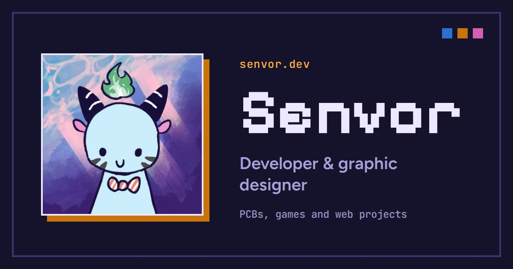

<div align="center">

# Hey there, I'm Senvor

**Developer and graphic designer. I learn by building things.**

Self-taught Hack Clubber making websites, PCBs, games and pixel art.


Live Preview: https://senvor.dev/



[](https://senvor.dev/)
[](https://github.com/Senvor)
[](https://reddit.com/user/senvor)
[](https://discord.com/users/1297888931169177653)
[](https://x.com/s3nvor)
[](https://instagram.com/s3nvor)
[](https://youtube.com/@s3nvor)

</div>

---

## About Me

Programming is one of my profound interests, and recently I heard about [Hack Club](https://hackclub.com/), a community for teens, by teens, where everyone gets to make cool projects.

It really inspired me to start making cool and useful things of my own. So far, I'm still pretty new to this field and I haven't made any great projects yet, just a few small ones. But I'm excited to keep learning, building, and seeing what I can create.

I'm currently building **Pocket Gravity Lab**, a portable physics lab for exploring gravity and orbital mechanics, written in C++ for the ESP32-S3.

## My Projects

### Hardware

- **[Starbie](https://github.com/Senvor/Starbie)** - A motion-controlled desktop pet on a custom PCB.
- **[DevRuler](https://github.com/Senvor/DevRuler)** - A custom PCB ruler for developers, with hardware footprints, everyday commands, and SI unit conversions.
- **[Pocket Gravity Lab](https://github.com/Senvor/Pocket-Gravity-Lab)** *(in progress)* - A portable physics lab for exploring gravity and orbital mechanics.
- **[Marbew](https://github.com/Senvor/Marbew)** *(in progress)* - A custom 3D-printed marble race, designed from scratch.
- **[Obsidian](https://github.com/Senvor/Obsidian)** *(up next)* - An obsidian-themed keyboard project. Planned, not started yet.

### Web

- **[Sound Galaxy](https://github.com/Senvor/Sound-Galaxy)** - Turns microphone input into a moving galaxy of particles in real time. [Live](https://soundgalaxy.senvor.dev/)
- **[Particle Physics](https://github.com/Senvor/Particle-Physics)** - A gravity simulation where particles pull on each other like tiny planets. [Live](https://particlephysics.senvor.dev/)
- **[Cockroach Janta Party](https://github.com/Senvor/Cockroach-Janta-Party)** - An informational site about the CJP movement. [Live](https://cockroachjantaparty.senvor.dev/)
- **[Tapdish](https://github.com/Senvor/Tapdish)** *(in progress)* - A food-ordering web app. [Live](https://tapdish.senvor.dev/)

### Games

- **[EvoGen](https://github.com/Senvor/EvoGen)** *(in progress)* - Generational life-sim where inheritance replaces respawning.

---

# Coding

## `HackaTime`


## `Github Activity`

[](https://git.io/streak-stats)

<div align="center">


</div>

---

# The Portfolio Site

This repo also hosts [senvor.dev](https://senvor.dev/) via GitHub Pages. It's hand-built with plain HTML, CSS and JavaScript, no framework.

## Features

- **Bloodline demo** - a tiny taste of EvoGen right in the hero: each creature passes its traits on with a few mutations, and you can save one as a PNG
- **Gravity sandbox** - drop or fling planets into orbit, switch scenes (solar system, binary star, planet + moon, chaos), tweak gravity and speed
- **DevRuler converter** - try the ruler's unit conversions (length, area, volume, mass, temperature)
- **Command menu** - press **Ctrl/Cmd + K** or **/** to jump to any section, project or profile
- **Random themes** - light and dark mode, and every refresh after your first visit picks one of 10 colour palettes
- **Live stats** - shipped / in progress counts read from `projects.json`, plus public repo count, last push per project and the latest commit from the GitHub API
- **Project pages** - one page per project, with a gallery lightbox, live demo loader for web projects and an animated pixel hero for projects without a photo
- **Pixel starfield**, typing line, scroll progress bar and scroll-reveal sections

## Getting Started

### Dependencies

- [Node.js](https://nodejs.org/) (only needed to rebuild the project pages)

### Running it locally

```
git clone https://github.com/Senvor/Senvor.git
cd Senvor
npx serve .
```

Any static file server works. Some scripts use `fetch` and ES modules, so opening `index.html` straight from disk won't fully work.

### Adding or editing a project

1. Edit `projects.json` (title, tagline, status, stack, images, write-up)
2. Run `node build.mjs`
3. It fills `project.template.html` for every project, writes `projects/<slug>/index.html`, and regenerates `sitemap.xml`

## Tech Stack

- **HTML + CSS** - the site and the project page template
- **JavaScript** - the demos, command menu, themes and GitHub stats
- **Node.js** - `build.mjs`, the little static generator for project pages
- **GitHub Pages** - hosting at senvor.dev
- **GitHub Actions** - generates the contribution snake every day

## `Site Files`

```
index.html               home page
404.html                 not-found page
project.template.html    template for project pages
projects.json            project data (order matches the home page)
build.mjs                node build.mjs → projects/*/index.html + sitemap.xml
projects/<slug>/         generated project pages (don't edit by hand)
css/                     style.css (site), project.css (project pages)
js/                      theme.js, script.js, home.js, extras.js, github-status.js, project.js
assets/                  favicon, touch icon, og.jpg
assets/icons/            social and brand SVGs
assets/projects/         project photos, renders and thumbnails
CNAME, robots.txt, sitemap.xml, .github/
```
